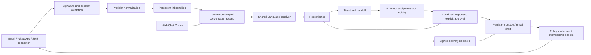

# Multi-channel messaging — Phase 4

Implemented in `test_mid` only. The Vue/FastAPI modular monolith and two existing agents are reused. LLM interpretation and calendar operations remain deterministic mocks; no proprietary semantic runtime is imported.

`messaging.py` owns transport routing/reliability, `messaging_adapters.py` owns provider payloads, `message_delivery.py` owns gated network delivery, and `orchestration.py`, `booking.py`, `tools.py` retain all business authorization. Direct Web Chat and existing voice paths use the same Store and Orchestrator. Connected messaging returns a queued message identifier, never a claim that a provider delivered it.

Migration 4 adds messaging events, channel/email thread maps, delivery attempts, approved templates, encrypted attachment metadata, authorized contact links and content deletion requests. Migrations 1–3 remain forward compatible. All new tables have tenant ownership and composite conversation foreign keys. No legacy database is opened or migrated.

Inbound routes derive assistant, service membership, tenant, sender and recipient from the configured connection and signed payload. A provider message cannot select an arbitrary assistant or conversation. Contacts are endpoint-specific; equal telephone numbers across channels do not merge identities. `/api/contacts/link` records an explicit operator-authorized association and evidence, without merging histories or granting delivery consent.

## Durable processing

- Signed ingress acknowledges after an atomic event + job commit. The original body is not retained. A stable semantic fingerprint prevents an event ID being reused with changed content. Provider identifiers survive normalization. Receipt timestamps are excluded from fingerprints for Twilio and status callbacks.
- Inbound jobs run transactionally with agent, approval and mock-calendar writes. Duplicate provider events return the existing receipt; tool execution uses the existing tenant/conversation action ledger.
- Outbox messages and jobs are persistent, with distinct identities for prompts, approval results, human replies and scheduled notifications. Changed content under an existing outbox identity is rejected.
- Workers atomically claim a send before releasing the database transaction for network I/O. Explicit rate-limit rejection uses exponential backoff, at most four automatic send attempts. Rate quotas are per connection and count attempts.
- Timeouts, ambiguous provider acceptance and expired sending leases become `uncertain`. They are never automatically resent. Permanent/policy failures enter `dead_letter`. `/api/jobs/{id}/retry` permits only known pre-send failures or explicit rate-limit rejection; unknown sends require external reconciliation.
- Signed callbacks are tenant/connection-bound and monotonic. Delivered/read messages are not downgraded by old callbacks. Mock accepted status is `simulated`, never `delivered`.

`POST /api/jobs/run` executes due appointment reminders and messaging jobs. `/api/messaging/run` executes a bounded messaging batch. Set `ASSISTANT_MESSAGING_WORKER_ENABLED=true` for the existing lifespan maintenance loop to run a batch about every 15 seconds using current configured service membership. Otherwise processing is explicit. This remains a single-process SQLite development topology, not a distributed queue.

## Notifications

Shared tenant templates contain key, channel, locale, subject, body, variables and status. Six keys exist in both locales: appointment_created, appointment_rescheduled, appointment_cancelled, reminder, follow_up, human_escalation. Appointment responses use existing approval execution; scheduled messages use `POST /api/notifications` with a known conversation, exact template variables, aware due date, explicit confirmation and idempotency event ID.

Reminders resolve contact/conversation language at execution time. Queued reminders carry appointment ID and start-time version. Rescheduling/cancellation cancels obsolete queued messages; delivery rechecks appointment status/version. Scheduled email is held as a draft when the connection policy requires review. Automated SMS/WhatsApp notifications require recorded consent; WhatsApp additionally enforces its service window and verified templates.

## Privacy and operating limits

Message content and attachment bytes have tenant retention expiry. Admin retention/redaction APIs clear content, attachment secrets, cached response bodies and pending outbox work. Conversation redaction also closes the conversation and cancels pending events for its endpoint. Contact identity, appointments, structured business approvals/tool arguments, agent handoffs and audit records remain under a separate owner-controlled retention policy. This is content redaction, not complete account erasure or GDPR certification. Backups and upstream provider data require separate deletion policies.

Attachments are validated and quarantined, never fetched from arbitrary remote URLs, executed, rendered as HTML or passed to tools as authority. A scanner/release/download workflow remains an integration gate. Raw provider bodies, credentials and customer message text are excluded from application error logs. Disable HTTP access logs when handling Meta verification query tokens; the supplied container command does so.

Usage records track inbound/outbound channel operations, callbacks, SMS units/segments, executor tools, receptionist execution, notification deliveries and provider errors. The mock LLM reports token counts as unknown (`null`); no invented token charge or production pricing is reported.

All live messaging, telephony and speech adapters remain **LIVE_UNVERIFIED**. No production-readiness claim is made.
