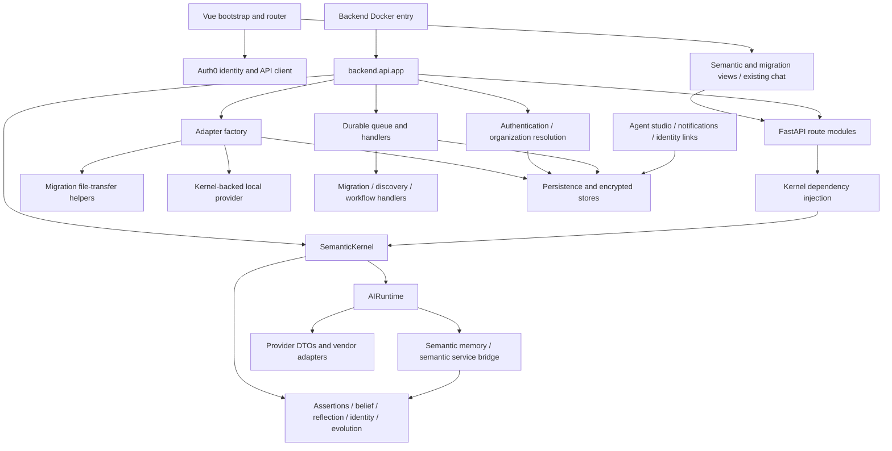

# Repository audit and proposed removal plan

Date: 2026-10-08. Scope: Phase 1 only. Owner approval is required before bulk deletion or Phase 2 implementation.

## Scope, safety and evidence

The Git root is `test_mid`; application code is under `semantic_os/`. Both `git rev-parse --show-toplevel` and the same command from the application directory resolve to this copy. No original repository was accessed or modified. Initial status was `?? semantic_os/`, on `main`. The repository has no commits: `git log -1` reports an unborn branch. The complete copied application is therefore untracked, not a committed rollback baseline. Branch `codex/phase1-repository-audit` was created and verified before writing this document. The initial sandboxed branch attempt failed; the permitted retry succeeded. No source files, database files, dependencies or credentials were changed, and nothing was staged or committed.

Evidence comprises a recursive file inventory excluding installed dependencies, compiled caches, build output and runtime workspaces; manifests; deployed and alternate entry points; API registrations and dependency injection; imports of the kernel and AI runtime; persistence and adapter factories; authentication; queue infrastructure; router and Vue bootstrap; containers and selected security/test sources. This is a static architectural audit, not a line-by-line security review or proof that every module is reusable. Classification of shared modules remains conditional until their transitive dependencies and tests are checked during extraction.

Environment files were identified by filename only. Credential values, runtime data and confidential disclosure/patent documents were not read or copied. Runtime workspaces and generated logs must not be treated as synthetic fixtures. No broad Git add is safe before an exclusion and secret review. No application startup, database migration, package installation or provider call was made.

## Stack and execution topology

| Area | Observed implementation | Implication |
|---|---|---|
| Backend | FastAPI, Uvicorn, Pydantic 2; `backend/requirements.txt` and optional `requirements-cloud.txt` | Preserve Python modular monolith; no framework replacement needed. Python dependencies use version ranges, with no discovered Python lockfile. |
| Production entry | `semantic_os/Dockerfile`: `uvicorn backend.api.app:app`; `backend/api/app.py` | This entry creates semantic runtime state and imports semantic routes eagerly. |
| Alternate entry | `semantic_os/main.py` | Imports the original `semantic_os_for_ai` namespace and nested semantic runtime paths; must be removed or replaced, not used as independent startup. |
| Frontend | Vue 3, Vue Router 4, TypeScript, Vite 8, Tailwind 4, Lucide, Auth0 SPA SDK | Reuse shell/components; npm package-lock exists. No existing i18n dependency was found. |
| UI entry | `frontend/index.html` → `src/main.ts` → `App.vue` and `src/router/index.ts` | Auth initialization precedes mount; router lazy-loads semantic and migration screens. Root-level `frontend/services/` duplicates some `src/services/` concerns and needs reachability review. |
| Persistence | `backend/persistence.py`: PostgreSQL/SQLAlchemy compatibility boundary, logical stores, organization-bound sessions and RLS setup | Legacy SQLite class/file names do not establish actual SQLite support. Never infer storage behavior from names. |
| Other persistence | `platform_core` SQLAlchemy models/repositories, local-named adapters, optional Spanner adapter | Multiple overlapping persistence models need consolidation; platform_core routes were not found registered in the deployed app. |
| Jobs | `jobs/durable_queue.py`: PostgreSQL leases, retries and row-locked claims; staging and concurrency helpers | Reuse queue mechanics after detaching semantic/migration handlers. No Redis/Celery requirement discovered. |
| Chat transport | `api/chat_stream.py`, AI routes and frontend chat components | Existing bounded SSE delivery is reusable in principle; no deployed WebSocket registration found in inspected app. |
| Deployment | Backend image with JVM/PySpark, gitleaks scan and non-root user; frontend nginx image with auth validation and security headers; Compose backend plus Spark | Current Compose is a data-processing topology, not the proposed assistant MVP. Cloud Run behavior exists in source/Docker comments; no CI workflow files discovered in this copy. |
| Tests | Backend pytest sources; frontend `.test.ts` and `.test.mjs`; security scanner Node tests | Existing artifacts/logs are not evidence of a current successful run. Package scripts have build/lint/auth validation, no general test or Vue typecheck script. |

Requirements also include OpenAI, cryptography, pandas, PyArrow, office/PDF parsers, cloud storage SDKs, SQL/database drivers, Paramiko, Sentry and Stripe. Stripe is listed twice. PySpark/JVM and connector SDKs should be reduced only after import reachability is resolved. Provider code currently resides within the agents tree rather than a separate infrastructure layer.

## Module decisions

Paths below are relative to `semantic_os/`. KEEP means preserve the independent mechanism, not claim it already satisfies SaaS requirements. REFACTOR means extract generic behavior before removing its semantic dependency. REMOVE applies to confirmed excluded responsibilities; REVIEW prohibits automatic deletion. Inbound/outbound columns describe important observed or structural dependencies, not an exhaustive symbol graph.

| Paths/module | Responsibility | Inbound dependencies | Outbound dependencies | Decision and rationale / planned change |
|---|---|---|---|---|
| `backend/api/app.py`, `api/dependencies.py` | App composition, lifecycle, DI | Container; API routes | Kernel, execution runtime, adapters, auth, jobs, semantic routers | REFACTOR: compose independent assistant services; eliminate kernel singleton and Kernel dependency only after consumers are replaced. |
| `main.py`, `backend/demo_api.py`, `desktop_runtime*.py`, `desktop_setup.py` | Alternate/demo/desktop bootstraps | Manual/desktop launch | Runtime profiles and semantic initialization | REMOVE semantic bootstrap; REVIEW desktop helpers for reusable configuration. Remove original namespace imports; never import the original tree. |
| `backend/kernel.py` | Aggregates knowledge, belief, reasoning, graph and AI runtimes | Deployed app, DI, services | Most domain engines and semantic agents | REMOVE after dependency extraction. This is a central cut point, not an ordinary generic service locator. |
| `backend/semantic_os/{assertions,identity,knowledge,runtime,reflection,self_healing,discovery}` | Excluded assertion, identity, evolution and repair mechanisms | Kernel/semantic services and tests | Dedicated semantic state/events | REMOVE confirmed excluded implementations and dedicated consumers. No renamed replacement. |
| `backend/semantic_os/{foundation,evidence,governance,observation}` | Shared semantic foundation and evidence/governance | Semantic runtimes | Assertion lifecycle and domain state | REVIEW: separate ordinary audit/authorization concepts from semantic governance before deletion. |
| `backend/belief*.py`, `reflection*.py`, `reasoning*.py`, `inference*.py`, `probability/` | Belief, reflection, inference and probabilistic semantic behavior | Kernel/intelligence | Domain entities, trust/semantic state | REMOVE excluded computation; REVIEW any independent numerical helpers individually. |
| `backend/{entities,relationships,metamodel,metamodel_registry,metamodel_graph,inheritance,ontology_schema,ontology_validator,ontology_loader,ontology_plugin}.py`, `ontologies/` | Ontology/entity model and loading | Kernel, graph, ontology API | Domain operations/registries | REVIEW/REMOVE semantic-domain ownership; retain no schema merely because it is generic-looking. |
| `backend/{compiler,rulecompiler,rules,constraint,consequences,datatypes,property_schema,property_validator,validator,matcher,patterns,employment_rule,operations,observation,context,goals,planner,engine}.py`, `core/` | Domain rules, planning and change engines | Kernel/workflows | Semantic model and events | REVIEW dependency closure; REMOVE dedicated lifecycle/semantic logic; extract only demonstrably ordinary validation helpers. |
| `backend/intelligence/`, `temporal/`, `versioning/`, `graph/`, `indexing/` | Semantic queries, temporal facts, graph and versions | Kernel, routes, retrieval | Semantic model/evidence | REVIEW: generic search/embedding primitives may survive; proprietary reasoning, drift/evolution and semantic version behavior must not. |
| `backend/migration/` | Data movement plus semantic mappings/reconciliation | Migration API, jobs, agents, adapter factory | Connectors, storage, semantic model | REMOVE `semantic_migration.py`, semantic mapping/reconciliation and repair mechanisms after tracing. REVIEW ordinary transfer/HTTP/record/location utilities, especially `file_transfer.py` imported by storage factory. Do not bulk-delete directory. |
| `backend/ingestion/`, `resources/`, `connectors/`, `connectivity.py` | Uploads, connectors, catalog, publication | Resources/discovery/publication APIs and jobs | SDKs, storage, permissions, semantic publication | REFACTOR generic file/storage access; REVIEW unnecessary data-platform features. Semantic discovery/publication must be detached. |
| `backend/api/routes/{semantic,ontology,graph,publication,discovery,migration,runtime}.py` | Semantic and migration API surface | App and frontend services | Kernel and associated domain services | REMOVE excluded endpoints; REVIEW graph/resource utilities individually. Remove route registrations and dependent clients in the same change set. |
| `backend/api/routes/{ai,workflow,automation_runs,schedule,monitoring,dashboard_metrics,admin,feedback,search,resources,capacity_usage,discovery_usage,github_webhooks}.py` | Mixed operations and API scaffolding | App/UI | Domain services, jobs, usage, access policy | REFACTOR/REVIEW: preserve authorized generic operations; replace semantic metrics, workflows and scheduling. Data migration schedules are not appointment scheduling. |
| `backend/api/{authentication,auth0_auth,identity_auth,account_linking,identity_links,self_signup,rate_limit,request_dependencies,dependency_deadlines,build_secret_access}.py` | Identity verification, linking, request control | App and protected routes | Auth0/JWT, durable identity stores, settings | KEEP/REFACTOR organization/account resolution for authenticated per-request tenant context. Preserve fail-closed verification and deadlines. |
| `backend/api/{semantic_access,scoped_ontology,reconciliation_access,search_access}.py` | Domain-specific authorization wrappers | Semantic/search routes | Kernel/domain policy | REVIEW: retain ordinary permission rules only after decoupling. Permission checks are not prohibited belief/trust algorithms. |
| `backend/api/routes/settings.py`, `platform_core/` | Users, organizations/projects, roles, settings, sessions | Auth/UI; platform_core appears alternate | Persistence, password/JWT, repositories | REFACTOR: reconcile active Auth0/account system with unused scaffold; verify memberships and request-level tenant isolation rather than add duplicate tenant columns blindly. |
| `backend/persistence.py`, `adapters/local_persistence.py`, `adapters/spanner_repository.py` | Database compatibility/store abstractions | Most durable services | PostgreSQL/SQLAlchemy, optional cloud SDK | KEEP/REFACTOR generic connection/transaction mechanisms. REVIEW constructor schema mutation and legacy data assumptions. |
| `backend/adapters/{secret_store,object_storage,vector_store,auth,graph_repository,factory}.py` | Encrypted secrets, storage/vector/graph adapters and composition | App/kernel | Persistence, file transfer, local semantic LLM | KEEP encrypted secret/vector/storage boundaries; REFACTOR factory; REVIEW licensing and semantic graph. Object storage currently assumes one verified organization per deployment. |
| `backend/runtime_mode.py`, `config/`, `retention.py`, `migrate_desktop_data.py` | Runtime settings, backup/retention and legacy migration | Bootstraps/storage | Workspace paths, existing stores | REFACTOR configuration; REVIEW retention and migration before touching data. Do not execute legacy migration during audit. |
| `backend/jobs/`, `workflows/`, `execution.py`, `execution/` | Durable worker, semantic/data workflows, Spark | Startup/API/agents | Persistence, migration, Spark | KEEP/REFACTOR queue primitives; REMOVE dedicated semantic job handlers; REVIEW Spark retirement once generic imports are detached. |
| `backend/agents/llm/provider.py`, `prompts/`, `llm/stream_context.py` | Provider-neutral generation DTOs, prompt rendering, stream hook | AI runtime and provider adapters | Mostly standard-library abstractions | KEEP/REFACTOR as core provider contracts with locale/capability metadata. Tool-call DTOs alone do not enforce permission. |
| `backend/agents/llm/{semantic_ai,local}.py`, `semantic_brain.py`, `semantic_search.py`, `memory/semantic_memory.py`, `tools/semantic_services.py` | Semantic AI fallback, brain/memory and service bridge | Kernel/AIRuntime | Semantic runtime and retrieval | REMOVE proprietary behavior. A kernel-backed local fallback cannot become the generic mock. |
| `backend/agents/llm/{anthropic_provider,vertex_endpoint,cloud_run_endpoint,model_artifact}.py` | Vendor/endpoint integrations | Provider selection | External APIs/config | REVIEW independent capability, auth and timeout handling; move retained adapters into infrastructure. No credentialed calls authorized by this audit. |
| `backend/agents/{runtime,conversation,planner,agents,retrieval,memory}/`, `studio.py`, `action_gateway.py`, `connector_policy.py`, evaluation/context helpers | Agent registry, tooling, conversations and governance | AI API/kernel | Semantic memory, service bridge, tools, persistence | REFACTOR generic configuration/history/policy; REMOVE existing knowledge/migration/governance agents and semantic routing. New receptionist/task agents require bounded validated handoffs. |
| `backend/agents/tools/{tool,registry}.py` | Tool schema and registry | AI runtime | Callable handlers | REFACTOR: schemas are reusable, but registry documents permissions as a future capability. Add tenant and agent checks, output/input validation, confirmation, budgets, audit and idempotency. |
| `backend/{notifications,observability,operational_telemetry,workload_usage,event_bus,event_logger,events,verification_evidence,production_readiness,production_intelligence}.py` | Notifications, logs, metering, evidence/readiness | App/jobs/API | SMTP, Sentry, persistence and mixed semantic state | KEEP ordinary telemetry/SMTP mechanics; REFACTOR semantic metrics/event types and localized errors; REVIEW evidence projections before retaining. |
| `backend/{stripe_billing,subscription_catalog,commercial_policy,business_entitlement,desktop_entitlement}.py`, `api/routes/{billing,refunds}.py` | Billing and product entitlements | App/settings/UI | Stripe, persistence, legacy product features | REFACTOR generic billing/usage; REVIEW old licenses/pricing and semantic entitlement names. No live payment actions. |
| `backend/{transaction,transaction_manager,transaction_events}.py`, `plugin_manager.py`, `plugin_loader.py`, `client.py`, `compat.py` | Transactions, plugins and compatibility | Kernel/clients | Domain events/operations | REVIEW: database transaction infrastructure is distinct from proprietary semantic transactions; trace before extracting. |
| `frontend/src/{App.vue,main.ts,assets}/`, generic `components/` | App shell, CSS tokens, forms, badges, empty states, dialogs | UI bootstrap/views | Router, identity, services | KEEP/REFACTOR shell and generic controls; add translation resources and persistent locale switcher; neutralize branding. |
| `frontend/src/router/`, `services/{navigation,navigationConfig,product}.ts`, semantic/migration/ontology/graph/discovery views and components | Navigation and proprietary workspaces | Sidebar/router/dashboard | Semantic API clients | REMOVE proprietary routes/widgets/clients together; REFACTOR navigation around functional assistant screens. |
| `frontend/src/components/ai/`, `services/{ai,chatHistory,confirmation}.ts`, AI/agent views | Existing chat/history and agent presentation | Router/UI | AI API, stream transport, semantic answer/migration cards | REFACTOR chat input/messages/history; REMOVE dedicated semantic panels/plans; distinguish mock/unconfigured state. |
| `frontend/src/services/{identity,auth,api,client,accountScope,userScopedStorage,clientErrors,cookiebot}.ts`, account/settings/payment components | Authenticated requests and account UX | UI/views | Auth0/API/storage | KEEP/REFACTOR persistent locale and tenant-aware caching; verify reset on identity/tenant change. Cookie consent integration requires deployment configuration review. |
| `frontend/services/`, frontend content/help/demo/public assets | Parallel service tree, tutorials and branding | Reachability not fully established | Old API/semantic concepts | REVIEW imports before removal. Remove old semantic demo/help material and generated assets only after source inventory. |
| `backend/tests/`, `frontend/tests/`, `security/` | Regression/security checks | Test runners/build | Existing domain/source fixtures | KEEP generic auth, isolation, secrets, retry and accessibility tests; REVIEW coupled tests; REMOVE dedicated semantic tests after approved runtime removal, replace with assistant acceptance coverage. |
| Dockerfiles, Compose, frontend build configuration, dependency manifests | Deployment/build | Containers/dev commands | Spark, SDKs, source scanners | REFACTOR after clean build; retain non-root/security/header checks. No new major dependency proposed in Phase 1. |
| `.env*`, `.ontelyx-workspace/`, caches, `dist/`, logs and installed packages | Credentials, state and derived artifacts | Runtime/tooling | Potential secrets/customer data/old runtime | REVIEW/protect data and secrets. Exclude from commits. Rebuild generated runtime artifacts later; deletion approval never authorizes database destruction. |

## Dependency graph and removal cut points

Observed critical edges are direct source imports: app→kernel/routes; DI→kernel; kernel→AIRuntime and semantic providers; AIRuntime→SemanticMemory and SemanticServiceBridge; factory→migration.file_transfer and kernel-backed LocalSemanticProvider. UI semantic routes are lazy imports, so removing a view without changing the router still breaks builds. Package removal must follow this graph transitively, including imports in `__init__.py`, test setup, workers and alternate launchers. Dynamic imports, provider selection and persisted job payloads need additional review; this graph is not a complete call graph.

## Security, tenant and data risks

Authentication currently centers on Auth0 verification, durable identity links, organization configuration and account-scoped access. PostgreSQL persistence sets `app.current_organization_id` and installs organization columns/RLS; this is reusable defensive infrastructure, not evidence that multi-tenant SaaS isolation already passes. Factory/storage comments explicitly assume one verified organization per deployment. Global kernel/runtime state, organization-bound adapters, object key prefixes, job context, user caches and agent studio need per-request tenant review. Ordinary account separation must remain distinct from tenant ownership.

No Alembic directory/config or numbered migration history was found in the inventoried source. Schema initialization occurs inside repository/queue code (`CREATE TABLE`, compatibility/RLS setup and alterations). These constructors are side-effecting: do not start the app merely to inspect it. Establish a forward-only migration ledger for new assistant tables, retaining existing tables/data. Fresh development databases may use a documented separate baseline with synthetic fixtures. Production legacy stores, encrypted keys, recordings, backups, persisted semantic objects and pending job payloads require an owner retention/disposition decision, not automatic deletion.

`backend/.env`, `.env.auth0`, `.env.example` and `.env.production.example` exist. Actual values were not inspected. Preserve secret encryption, source/build scans, request throttling and safe stream error logging. Existing encryption/key files and deployment organization assumptions need a design review before multi-tenant secret rotation. This audit is neither a security certification nor a legal opinion; uncertain IP boundaries stay REVIEW.

## Assistant acceptance gaps

| Required capability | Current evidence | Required implementation after approval |
|---|---|---|
| Two cooperating agents | Existing knowledge/migration/governance/analyst agents and semantic AIRuntime | New business-neutral receptionist/task executor; neutral handoff schema, limits, authorization and audit. |
| Tenant-configured assistants | Organization/accounts and agent studio exist | Assistant aggregate, tenant memberships, settings/secrets and cross-tenant denial tests. |
| Web chat | Existing chat UI and bounded SSE around authorized AI handler | Independent conversation service, durable history, explicit language switch and generic orchestrator. |
| Voice | No dedicated telephony/STT/TTS/session module identified | Mock full lifecycle, replaceable SIP-compatible interfaces and real speech evaluation. Bulgarian support is unverified. |
| Email | Generic SMTP notification implementation | Inbound ingestion/threading/MIME, normalized adapter, approvals and bilingual templates. SMTP notifications alone are not a complete channel. |
| WhatsApp | No official Business Platform channel identified | Verified webhooks, messaging-window checks, provider templates/status callbacks; mock contract first. |
| SMS | No dedicated SMS channel identified | E.164, opt-out, callbacks, Cyrillic/GSM-7/UCS-2 segmentation and metering. |
| Bilingual UX | English document language and hard-coded errors; no resource system found; `bg-BG`/`en-US` runtime-source search matched only ChatInput.vue | Separate UI/conversation/voice locale; resolver precedence and uncertainty; complete bg-BG/en-US resources and tests. Existing mentions do not prove coverage. |
| Appointment tools | Migration/data schedules, generic tool registry | New timezone-aware appointment domain; validated confirmed writes, idempotency and structured outcomes. |

Retain modular-monolith topology: domain/application contracts depend on no SDK; infrastructure implements provider and repository ports; FastAPI assembles tenant-scoped services; Vue consumes authorized APIs. Proposed modules are identity/tenants, assistant configuration, orchestration, conversations/contacts, channel gateway, voice, tools/appointments/follow-ups, notifications/localization, provider configuration and usage/audit. This is a preliminary direction, not completion of the later TARGET_ARCHITECTURE deliverable.

## Approval-gated removal sequence

1. **Secure the baseline.** Before implementation, review untracked files and ignore policy. Create a sanitized source baseline only after secret/confidential/data exclusions; never commit the entire copy indiscriminately. Preserve runtime data outside any deletion set with owner-approved retention. Re-read applicable frontend instructions before editing frontend code.
2. **Measure the existing baseline safely.** Inspect test imports and required configuration, then run offline checks in an isolated synthetic environment. Record existing failures. Database tests must use an explicit disposable database. No networked connector/payment/auth/live-provider tests without configuration and authorization.
3. **Extract generic infrastructure.** Introduce independent composition and tenant context while retaining auth, RLS, encrypted secrets, storage and queue contracts. Move file-transfer storage helpers out of migration if retained. Remove the kernel-backed fallback from adapter composition. Keep old source temporarily unreachable until retained consumers are traced.
4. **Cut semantic startup and DI.** Replace app startup/Kernel injection and alternate namespace entry point; detach semantic routes, workers, seeds and dedicated event registrations. Restore an offline clean import/build before proceeding.
5. **Remove confirmed excluded closures.** Delete assertion/knowledge identity/evolution/belief/reflection/self-healing runtimes, semantic memory/service bridge, semantic discovery/mapping/reconciliation/repair, old agents and dedicated tests only when retained imports are clear. REVIEW modules receive individual decisions. Generic conversation memory, RAG, vectors, audit and security permissions remain eligible for reuse.
6. **Remove coupled UI.** Update router, navigation, clients, dashboards/help and dedicated components together. Preserve reusable shell, identity, forms, chat primitives and tokens; introduce bilingual resources from the first replacement screen.
7. **Prune packages/artifacts.** Remove SDKs/Spark/JVM only when no retained imports need them. Regenerate locks and builds; invalidate derived semantic caches/bundles only inside verified development paths. Do not remove workspace databases or applied schemas.
8. **Verify and report.** Scan source/imports/routes/navigation/configuration for stale proprietary and original-namespace references; classify remaining documentation/test mentions. Run retained security/isolation/build checks. Produce SEMANTIC_REMOVAL_REPORT with exact files, migration effects, unresolved boundaries and observed results before further phases.

Approval requested covers this sequence and confirmed REMOVE responsibilities, with mandatory individual review of mixed components. It does not authorize live provider calls, production data/schema deletion or copying confidential materials. Phases 3–15 remain later work; no mock or live integration is delivered by this audit.

## Validation record and next checks

Executed: Git root/status/branch inspection; recursive file inventory and targeted `rg` import/route/locale searches; manifest and selected source/container reads; `node --version` (v24.19.0), `python --version` (3.12.10). Git branch creation was verified. No source modification or deletion occurred. Baseline logs and cache files were disregarded as verification evidence.

Not executed: installation, frontend build/lint/typecheck, pytest, secret scanning of the whole copy, Docker build/startup, database migration, live speech/integration samples. They are not claimed as passing. The copied source is untracked and there is no historical rollback commit; this remains the most immediate implementation risk.

Planned checks after safe baseline review: `node --test semantic_os/security/scan-secrets.test.mjs`; frontend `npm run build`, `npm run lint`, `npx tsc --noEmit` (plain tsc does not fully check Vue SFC templates); review and run individual Node test files according to their imports/runtime; pytest auth/isolation/queue/secret-store tests with synthetic configuration and explicit disposable persistence. Build output and scanner failure logs must be redacted. Add bilingual channel/agent/tool tests during later implementation, including duplicate webhook and cross-tenant execution denial; mock speech tests never substitute for real bg-BG/en-US samples.

Phase 1 change set: this audit document only. Decision: reuse Vue/FastAPI and generic infrastructure, perform dependency-led extraction, and stop for owner approval before implementation or bulk deletion.
