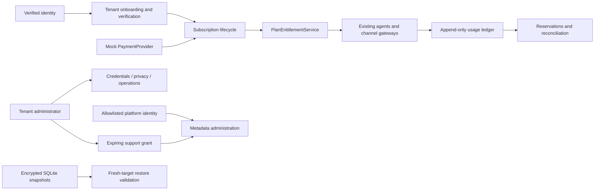

# SaaS architecture — Phase 5

The existing FastAPI/Vue modular monolith, Store, two agents, tool registry and channel gateways are preserved. Migration 5 adds a conventional SaaS plan catalog, subscriptions/items/customers/invoices/payment events, immutable billing usage, reservations/warnings, onboarding/verification, reconciliation, privacy requests, support grants and operational records. Migrations 1–4 are unchanged. No proprietary semantic runtime is introduced.

## Tenant onboarding

`POST /api/saas/register` requires an authenticated identity but no existing membership. Tenant IDs are server-generated; matching organization names/email addresses never grant membership in another organization. Registration creates its initial administrator, default assistant, two agents, selected language/timezone and billing customer. A registration event ID is identity-bound and immutable.

States are created, pending_verification, configuring, active, suspended and cancelled. A verified identity email claim must match the submitted administrator mailbox. Otherwise the tenant remains pending. Development demo verification uses a hashed, expiring, single-use token and encrypted mock message; this path is unavailable in staging/production. Real deployment must configure verified email claims through the identity provider. No live verification email service is claimed.

The tenant selects an enabled plan and configured trial or checkout. A trial cannot be reset by repeat requests. Restricted resources require verified, active tenant/subscription state. Billing/onboarding/profile/usage/privacy recovery routes remain available to authorized members so they can resolve account problems. Platform suspension survives payment; only separately authorized platform access can clear it.

Legacy synthetic development tenants remain usable without commercial subscriptions. Staging/production require subscriptions; that development allowance does not grant production access.

## Entitlements

Central entitlements enforce active assistants, agents, users and connections; monthly AI/agent/tool/channel usage; voice admission budgets; encrypted storage and history retention. Active-resource re-enabling is checked as well as creation. Disabling a resource releases its allocation. Downgrades must fit active resource allocations, then apply at renewal. Prices and limits are configured through the platform-only plan API, not hard-coded commercial business logic.

Monthly voice-minute configuration converts exactly to integer seconds. Subscribed tenants use the central monthly ledger rather than the older development lifetime operational-record counter.

Hard limits block; soft limits warn or meter. Usage warnings are deduplicated per category/month. AI/tool execution reserves ledger units inside the existing transaction before mock execution. Outbound capacity is reserved before network dispatch, so concurrent workers cannot both spend the same last allowance. Unknown sends retain reservations and are not blindly retried. Signed status callbacks settle usage idempotently. Opt-out acknowledgment is a safety exception to normal SMS limits.

## Administration and privacy

Tenant administration uses existing RBAC. Platform authority comes from an explicit verified-subject allowlist, independently of tenant-admin roles. Platform overview contains organization/subscription/resource metadata; it does not expose customer conversations. Tenant admins may authorize/revoke an expiring, audited support read grant. Grants do not authorize tools or exports by default.

Tenant/contact exports exclude credentials, verification tokens and encrypted media bytes. Explicit two-step erasure requests support conversation, contact or tenant scope; active calls block execution. Tenant erasure removes operational/personal records and revokes access while retaining pseudonymous financial ledger, financial records, audit and request receipts. Upstream providers/backups/legal retention remain owner responsibilities. There is no automatic startup production deletion or GDPR certification claim.

## Operating topology

One Uvicorn process, one local SQLite/WAL database, bounded voice executor and the existing maintenance worker are the supported MVP topology. Do not run multiple replicas against this shared file as a scaling strategy. Operations expose content-free timing/error aggregates, current worker state, failed jobs and connection state. External metrics export, pagination, distributed rate limits, production storage/managed identity/payment accounts and real capacity verification remain integration gates.
