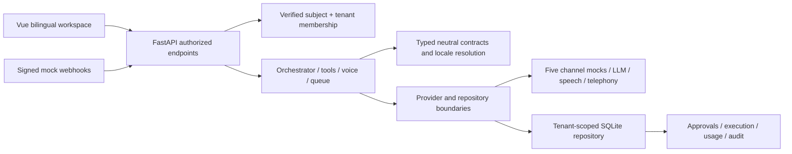

# Target architecture

Implemented as a modular monolith: one FastAPI process, one persistent development database, one Vue application. No distributed infrastructure is needed for mock MVP execution. The existing directory name is a package location only.

| Module | Ownership and implementation |
|---|---|
| Identity & Tenants | `assistant/security.py`, `api/auth0_auth.py`, store memberships and role grants; server-checked tenant selector; offline initial provisioning |
| Assistants & Agent Configuration | `domain.py` configuration DTOs; authenticated API and persisted tenant-owned assistants/agents |
| Agent Orchestration | `orchestration.py`: receptionist, validated executor handoff, explicit approvals, budgets and correlation |
| Booking dialogue / calendar | `booking.py`: explicit agent classes and persistent natural-language state; `calendar.py`: injected mock CalendarProvider behind the existing tool registry |
| Conversations & Contacts | Tenant-owned conversation/contact/message repositories in `store.py`; history and confirmed contact selection |
| Communication Gateway | Orchestrator normalizes processing and idempotency across all channel contracts |
| Voice | `voice.py`, telephony/STT/TTS ports in domain; synthetic lifecycle implementations in providers |
| Channel adapters | Separate voice/email/WhatsApp/SMS/web-chat adapter classes in `providers.py`; MIME helper in `email.py` |
| Tools / Appointments / Follow-up | `tools.py` registry, typed schemas, authorization/confirmations, mock business actions and conflict detection |
| Notifications / Localization | `language.py`, locale-specific persisted templates, explicit reminder queue in `jobs.py` |
| Provider Configuration | Registry capability metadata and encrypted tenant-owned signed mock channel connections |
| Usage / Audit / Observability | Usage, tool/agent execution and audit records; redacted structured failures; retained rate limiter; live/readiness checks |
| Presentation | Vue App shell/router, reusable EmptyState, localized workspace screens and session-aware API client |

Dependency policy: domain has no vendor SDK or database imports. Application code uses injected store/provider objects; infrastructure owns SQLite, Fernet, JWT/JWKS and mock dispatch. Reused LLM transport DTOs are in `agents/llm/provider.py`, without semantic provider implementation. Format utilities are currently colocated with mock provider code; before adding SDKs, move format utilities to a neutral communication module or keep SDK imports isolated in separate adapter modules. The composition root is `assistant/api.py`; deployed `api/app.py` only calls its factory.

The old deployed composition required a global kernel and data/migration workers. It was replaced with tenant-scoped application services. The unregistered `platform_core` scaffold had missing `database.session` dependencies, invalid absolute package imports and service/repository circular wiring; it was reviewed and removed, with active tenant/user functionality implemented in the new module. The old PostgreSQL dialect/semantic persistence layer was not used for the fresh mock baseline. No legacy database was migrated or deleted.

MVP constraints: single process; SQLite serialized writes; unpaginated history/list APIs; manually dispatched due reminders; mock-only execution; no streaming from the deterministic provider; no account signup/password reset implementation beyond configured Auth0. Preserve current ports when adding tested production persistence/providers. Live SDKs belong in new infrastructure modules, never in domain or prompt-authorized tools.
