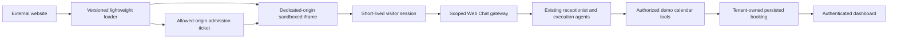

# Proposed widget architecture

Plan reviewed against existing code on 10 October 2026; implementation/verification status is recorded separately.

The host gets a one-use ticket, not a staff bearer token. The iframe holds its visitor credential in memory and uses only widget endpoints. Server resolution binds public ID → tenant → integration → immutable version → conversation. Every message rechecks lifecycle/epoch, expiry, quota, published policy and ownership. Anonymous clients cannot select a tenant, assistant, tool or arbitrary conversation ID.

Published visitor configuration is read by the existing orchestration through an internal, server-created conversation snapshot reference; normal channels keep their current behavior. Allow only availability, explicit confirmed demo booking and human escalation when configured. Disable cancellation/rescheduling, messages, follow-up creation and other privileged actions for visitors.

Static assets and iframe/API have a dedicated origin. App authentication and private model/SIP endpoints are not proxied there. Parent and iframe validate origin, window source, namespace, nonce and message schema; frame CSP permits only verified embedding origins. Website allowlisting cannot authenticate a human or defeat forged non-browser Origin headers. Short TTL, one-use tickets, restricted capabilities and quotas are separate layers.

Existing single-process SQLite remains the demo topology. Cloud scaling requires a shared database/queue and distributed quotas; a CDN plus request-bound application service does not make long-lived SIP/RTP transport cloud-ready.
