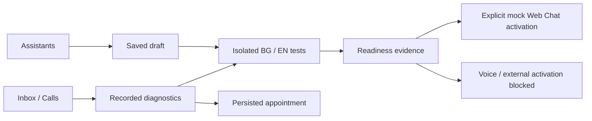

# Original navigation and wireframes — review proposal

Stage A; not implemented. Existing fourteen URLs remain. Proposed grouping: Operate (Dashboard, Inbox, Calls, Appointments); Build (Assistants, Agents during transition, Channels, Integrations); Manage (Settings, Onboarding, Billing, Usage, Operations, Administration). Roles affect actions; backend remains authority. Grouping reduces navigation scanning without deleting pages.

## Setup wireframe

```text
Assistant setup / Настройка на асистент          Draft / Чернова
Use case > Business > Languages > Tools > Channels > Test > Review
Step 2: Your business / Вашият бизнес
[Business name] [Timezone: Europe/Sofia]
[Working days and hours] [Services and duration]
Validation next to the relevant field; errors summarized with links
Back / Назад   Save and exit / Запази и излез   Continue / Продължи
```

One primary Continue action. Save/resume confirmation reports actual server result. Cancellation archives draft after confirmation and never disables the current assistant. No patient data in setup.

## Assistant overview and testing wireframe

```text
Clinic assistant / Асистент на клиниката   Active version / Активна версия
[Test Assistant / Тествай асистента]       Edit draft / Редактирай чернова
Readiness / Готовност: Voice acceptance blocked / Гласовото приемане е блокирано

Test studio / Студио за тестове           Isolated mock / Изолирана симулация
[BG / EN] [Scenario / Сценарий] [Run / Стартирай]
Conversation / Разговор     | Evidence / Доказателства
Synthetic input and reply  | Locale → Agents → Tools → Booking state
Result: PASS / FAIL / BLOCKED, translated explanation and actual elapsed time
No live appointments or messages; no claims about audio quality
```

Configuration hash/version and synthetic clock/timezone appear in test details. Primary Run cannot create a real call. Advanced raw diagnostics are sanitized and permission-controlled.

## Operational debugger wireframe

```text
Conversation / Разговор   Call ID / ID на обаждане   [Appointment / Час]
Outcome / Резултат: No appointment / Няма записан час
Recorded timeline / Записана хронология
Availability succeeded → Proposal pending → Confirmation not recorded
Booking: Not recorded   Audio receipt: Not human-verified
[Correlation, timestamp, measured duration, safe error details]
```

Actual ordering uses recorded timestamps and stable tie-breaking, not diagram position. Expected-stage coverage sits separately with Succeeded/Failed/Not recorded/Not applicable labels. No synthesized events or private reasoning. Audio sent is distinct from caller hearing.

Accessibility specification: native buttons/labels/fieldset legends; step heading focus on navigation; skip link; error summary focus and field links; status live region; text plus icons for state; readable wrap for Cyrillic; mobile single column; keyboard navigation with no trapping. Visual contrast and real keyboard execution require testing after implementation.

## Phase 11 implemented navigation

Owner-approved incremental redesign, 10 October 2026. Primary: dashboard, assistants, inbox, testing, calls, appointments, operations, integrations, settings. Advanced: setup, agents, channels, onboarding, billing, usage, administration. URLs are preserved; setup/testing are new. Testing/operations require execution-role navigation; administration depends on platform membership. Backend permissions remain authoritative.

Assistants → read-only Overview/Instructions/FAQ when present/Tools/Channels/Voice/Testing/Versions/Activity → explicit draft editing. Setup saves and resumes seven steps. Test Studio reviews synthetic BG/EN outcomes. Calls/Inbox → recorded debugger → linked appointments/conversation. Legacy direct active editing remains visibly Advanced with a warning; it is not presented as draft promotion.



Structured breadcrumbs, advanced layout customization and measured navigation usability remain future work. Contextual return links and tenant/environment labels are implemented; a new duplicate signup or tenant identity system is not introduced.
